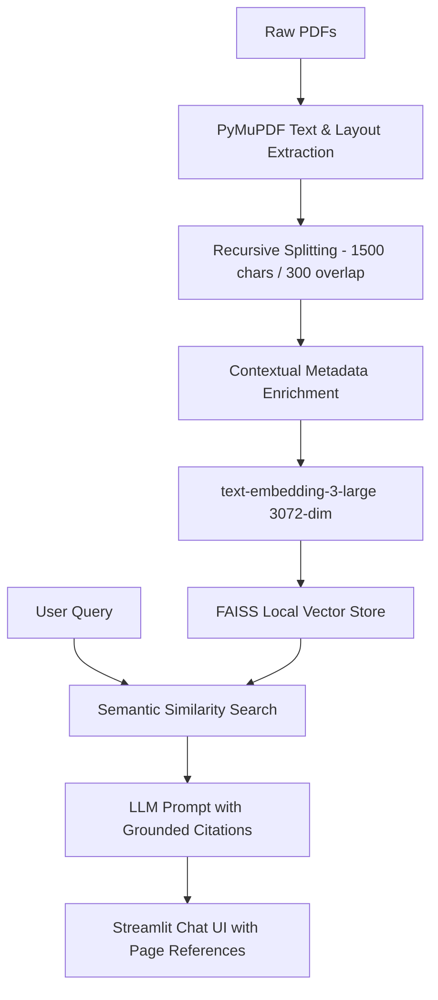

# Kulliyat AI — Context-Enriched Production RAG Pipeline

A high-fidelity Retrieval-Augmented Generation (RAG) system built with **Python**, **LangChain**, and **Streamlit** designed to ingest complex multi-page PDF documents, extract layout-aware text, and perform semantically grounded question answering with exact source citations.

---

## Technical Highlights

- **Layout-Preserving PDF Parsing:** Uses `PyMuPDF` (`fitz`) rather than naive text dumping to retain columns, table context, and Turkish character encoding integrity.
- **Contextual Chunk Enrichment:** Implements metadata prepending directly into document chunks (`[Kaynak: <filename> | Sayfa: <page>]`), drastically improving retrieval precision for dense technical and academic texts.
- **High-Dimensional Vector Space:** Embeds text using OpenAI's `text-embedding-3-large` (3072 dimensions) indexed in an in-memory `FAISS` vector store.
- **Multi-Model Inference:** Dynamic model routing between Google Gemini Flash, Gemini Pro, and Claude 3.5 Sonnet depending on query complexity and latency requirements.
- **Enterprise Credential Handling:** Secure key resolution across local environment variables and Streamlit secrets.

---

## RAG Architecture



---

## Tech Stack

- **Language:** Python 3.11+
- **Document Ingestion:** PyMuPDF (`fitz`)
- **RAG & Orchestration:** LangChain, LangChain Core
- **Vector Database:** FAISS (`faiss-cpu`)
- **Embeddings:** OpenAI `text-embedding-3-large`
- **Frontend:** Streamlit

---

## Local Setup

### 1. Clone & Install Dependencies

```bash
git clone https://github.com/mmkaya-ui/kulliyatai.git
cd kulliyatai
pip install -r requirements.txt
```

### 2. Environment Configuration

Create a `.env` or `.streamlit/secrets.toml` file with your API keys:

```bash
OPENAI_API_KEY="sk-..."
GOOGLE_API_KEY="AIza..."
OPENROUTER_API_KEY="sk-..."
```

### 3. Ingest Documents

Place your target PDF files into `my_pdfs/` and run the vector ingestion pipeline:

```bash
python ingest.py
```

### 4. Run the Streamlit Application

```bash
streamlit run app.py
```
