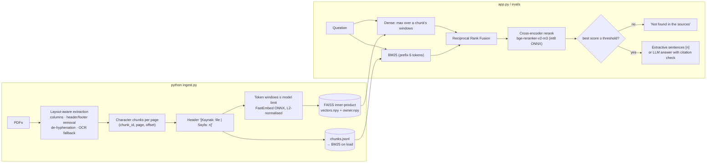

# Külliyat AI — multilingual hybrid RAG with a benchmark you can check

Ask questions about a folder of PDFs in Turkish, English or German and get answers that cite
the exact file and page. It runs fully offline by default: local ONNX embeddings, a local
cross-encoder reranker and an extractive answer mode that needs no LLM or API key. When the
sources do not contain the answer, it says so instead of guessing. Gemini, OpenAI or Claude
(through OpenRouter) can write the final answer if you add an API key.

The repository ships with a small public-domain corpus (two Turkish texts, two English, one German)
and a benchmark whose labels, numbers and documentation are generated and checked by code.

## What is different here

Each point below names the code that implements it and the test or measurement that backs it.

1. **Benchmark labels are machine-verified.** Every question in
   [`evals/questions.jsonl`](evals/questions.jsonl) carries a verbatim evidence quote. At load time
   each quote must be found exactly once in the text extracted from the PDF; pages are derived from
   it, never typed by hand. Unanswerable questions list the terms that would carry the answer, and
   the validator checks that none of them occurs anywhere in the corpus
   ([`evals/dataset.py`](evals/dataset.py), [`tests/test_dataset.py`](tests/test_dataset.py)).
   Attaching evidence to the previous 35 questions exposed several wrong labels (see
   [Corrections](#corrections-to-earlier-versions)).
2. **Documentation cannot drift from the data.** The benchmark block below and
   [`evals/RESULTS.md`](evals/RESULTS.md) are rendered from `evals/results/results.json` by
   [`evals/report.py`](evals/report.py), including every comparative sentence and p-value;
   `python -m evals.report --check` (run by the tests and CI) fails if they disagree.
3. **Selection and reporting are separated.** All settings are chosen on a dev split, all
   reported numbers come from a held-out test split, with 95% bootstrap confidence intervals and
   paired permutation tests ([`evals/run.py`](evals/run.py), [`evals/metrics.py`](evals/metrics.py)).
4. **Long chunks are no longer silently truncated.** The multilingual MiniLM embedder only reads the
   first 128 tokens (about 450–500 characters of Turkish or German), so with 1000–1500-character
   chunks the dense retriever never saw most of each chunk. Chunks are now embedded as overlapping
   windows that fit the model, and a chunk scores as its best window, the "MaxP" approach of
   Dai & Callan, SIGIR 2019 ([`rag/index.py`](rag/index.py), [`rag/chunking.py`](rag/chunking.py)).
   Its effect is one of the ablations in the benchmark.
5. **No-LLM answers and abstention.** The cross-encoder's score for the best passage acts as a
   confidence gate, calibrated on dev answerable questions only. Answers are the best-scoring source
   sentences, copied verbatim with `[n]` citations ([`rag/answer.py`](rag/answer.py)). Both are
   measured on the test split.
6. **Layout-aware PDF parsing with OCR fallback.** It reads two-column pages in the right order,
   removes running headers, footers and page numbers, rejoins words hyphenated across lines, and
   OCRs image-only pages with Tesseract when it is installed. Each behaviour is tested on synthetic
   PDFs built inside the tests ([`rag/loading.py`](rag/loading.py),
   [`tests/test_loading.py`](tests/test_loading.py)).
7. **The corpus is reproducible byte for byte.** The PDFs are rendered offline from committed text
   with a bundled font. `python scripts/build_sample_docs.py --check` rebuilds them and compares
   SHA-256 hashes with [`sample_docs/corpus.json`](sample_docs/corpus.json)
   ([`tests/test_corpus.py`](tests/test_corpus.py)).
8. **The index contains no pickle.** It is saved as JSON lines plus `.npy` arrays, so loading it
   cannot run code. The previous LangChain FAISS store needed `allow_dangerous_deserialization=True`.

## Benchmark

<!-- BENCHMARK:START (generated by `python -m evals.report`) -->

Test split: 63 answerable + 13 unanswerable questions (settings chosen on a separate dev split of 41). Mean with 95% bootstrap CI.

| System (test split) | Hit@1 | Hit@3 | Hit@5 | MRR@10 | Evidence recall@5 | Latency median / p95 |
|---|---|---|---|---|---|---|
| **BM25** | 0.460 <sub>[0.33, 0.59]</sub> | 0.651 <sub>[0.54, 0.76]</sub> | 0.698 <sub>[0.59, 0.81]</sub> | 0.559 <sub>[0.45, 0.66]</sub> | 0.667 <sub>[0.56, 0.78]</sub> | 0.6 ms / 0.8 ms |
| **Dense** | 0.460 <sub>[0.35, 0.59]</sub> | 0.635 <sub>[0.51, 0.75]</sub> | 0.683 <sub>[0.57, 0.79]</sub> | 0.562 <sub>[0.46, 0.67]</sub> | 0.643 <sub>[0.53, 0.75]</sub> | 7.0 ms / 11.0 ms |
| **Hybrid (RRF)** | 0.429 <sub>[0.30, 0.56]</sub> | 0.556 <sub>[0.43, 0.68]</sub> | 0.698 <sub>[0.59, 0.81]</sub> | 0.539 <sub>[0.44, 0.64]</sub> | 0.683 <sub>[0.56, 0.79]</sub> | 7.2 ms / 10.3 ms |
| **Pre-v2 settings (hybrid)** | 0.270 <sub>[0.16, 0.38]</sub> | 0.508 <sub>[0.38, 0.63]</sub> | 0.587 <sub>[0.46, 0.70]</sub> | 0.410 <sub>[0.31, 0.51]</sub> | 0.548 <sub>[0.43, 0.67]</sub> | – |
| **Hybrid + rerank** | 0.794 <sub>[0.70, 0.89]</sub> | 0.873 <sub>[0.79, 0.95]</sub> | 0.889 <sub>[0.81, 0.95]</sub> | 0.837 <sub>[0.75, 0.92]</sub> | 0.873 <sub>[0.79, 0.94]</sub> | 8,923 ms / 10,648 ms |

- Best test MRR@10: **Hybrid + rerank** with 0.837 (95% CI 0.75–0.92).
- Hybrid + rerank vs Hybrid (RRF): MRR@10 +0.298, paired permutation p < 0.001 (significant at α = 0.05).
- Hybrid (RRF) vs Pre-v2 settings (hybrid): MRR@10 +0.129, paired permutation p = 0.008 (significant at α = 0.05).
- Hybrid (RRF) vs BM25: MRR@10 -0.020, paired permutation p = 0.717 (not significant at α = 0.05).
- Hybrid (RRF) vs Dense: MRR@10 -0.024, paired permutation p = 0.581 (not significant at α = 0.05).
- Largest single-factor effect: *dense windows -> single vector* changes hybrid MRR@10 by -0.166 (p = 0.001).
- Reranking costs 8,901 ms median per query on 2 CPU threads (Intel(R) Xeon(R) Processor @ 2.10GHz); the first stage takes 7.2 ms.
- Abstention gate (no LLM): keeps 95.2% <sub>[89, 100]</sub> of answerable and refuses 46.2% <sub>[23, 77]</sub> of unanswerable test questions (n = 13 unanswerable; AUROC 0.91).

Full tables (significance tests, per-language breakdown, ablations, latency per stage, dev grid): [`evals/RESULTS.md`](evals/RESULTS.md).

<!-- BENCHMARK:END -->

What the metrics mean: a retrieved chunk is **relevant** if it contains at least half of an
evidence quote. **Hit@k** is the share of questions with a relevant chunk in the top k. **MRR@10**
is the mean of 1/rank of the first relevant chunk. **Evidence recall@5** is the share of a question's
evidence quotes that are covered within the top 5 (some questions need two quotes).
**Latency** is measured with the embedding and reranker caches bypassed, after a warm-up, on the CPU named in
`RESULTS.md`.

## Architecture



## Quickstart

Requires Python 3.11 or newer. The first run downloads the two ONNX models from Hugging Face
(about 0.25 GB for the embedder and 0.57 GB for the reranker) into FastEmbed's cache folder.

```bash
git clone https://github.com/mmkaya-ui/kulliyatai.git
cd kulliyatai
python -m venv .venv
.venv\Scripts\activate            # Windows
# source .venv/bin/activate       # Linux / macOS
pip install -r requirements.txt   # or, for the exact tested versions: pip install -r requirements.lock

python ingest.py                  # index sample_docs/ into vector_db/
streamlit run app.py              # http://localhost:8501
```

The default answer mode, *Kaynak cümleleri*, works without any key. To enable an LLM mode, copy
`.env.example` to `.env` and set `GOOGLE_API_KEY`, `OPENAI_API_KEY` or `OPENROUTER_API_KEY`.

### Your own PDFs

```bash
python ingest.py --data-dir my_pdfs --db-dir vector_db_private
# then start the app with DB_DIR=vector_db_private (in .env or the environment)
```

`my_pdfs/` and every `vector_db*/` folder are git-ignored. Ingestion prints, for every file, how many
pages were read from the text layer, OCR'd, or skipped. Scanned pages are OCR'd only if Tesseract
and the language data in `OCR_LANGUAGES` (default `tur+eng+deu`) are installed; on Windows, install
Tesseract (for example the UB Mannheim build) and set `TESSDATA_PREFIX` to its `tessdata` folder.

## Commands

| Command | What it does |
|---|---|
| `python ingest.py` | Build the index (`--data-dir`, `--db-dir`, `--chunk-size`, `--no-ocr`) |
| `streamlit run app.py` | Start the chat UI |
| `python -m pytest` | Unit and verification tests; no models, no network |
| `RUN_MODEL_TESTS=1 python -m pytest` | Adds end-to-end tests with the real models: ingest, retrieval, Streamlit app |
| `python -m evals.dataset` | Verify the question set against the PDFs |
| `python -m evals.run` | Full benchmark (`--no-rerank` for a quick first-stage-only run) |
| `python -m evals.report [--check]` | Re-render, or check, `RESULTS.md` and the README block |
| `python -m evals.generation --provider google --model …` | Optional: evaluate LLM answers (needs a key) |
| `python scripts/build_sample_docs.py [--check]` | Rebuild, or verify, the sample PDFs |
| `python scripts/audit_repo.py` | Check git history for private or large files |

The `Makefile` wraps the same commands (`make test`, `make eval`, …) for shells that have `make`.

## Configuration

All settings are environment variables (or `.env`, see [`.env.example`](.env.example)). The retrieval
defaults in [`rag/config.py`](rag/config.py) are the dev-selected values, and a test fails if they
differ from `results.json`.

| Variable | Default | Meaning |
|---|---|---|
| `DATA_DIR` / `DB_DIR` | `sample_docs` / `vector_db` | PDF folder / index folder |
| `EMBEDDING_PROVIDER` | `fastembed` | `fastembed` (local), `google` or `openai` |
| `CHUNK_SIZE` / `CHUNK_OVERLAP` | dev-selected | characters |
| `CONTEXTUAL_HEADER` | dev-selected | prefix `[Kaynak: file \| Sayfa: n]` to indexed text |
| `DENSE_WINDOWS` | dev-selected | embed long chunks as windows (MaxP) |
| `BM25_TOKENIZER` | dev-selected | `plain` or `prefixN` (truncate words to N characters) |
| `CANDIDATE_K` | dev-selected | first-stage candidates passed to the reranker |
| `ABSTAIN_THRESHOLD` | dev-calibrated | reranker score below which the app says "not found"; `off` disables |
| `ANSWER_LANGUAGE` | `tr` | `tr`, `en`, `de`, or `auto` (language of the question) |
| `LLM_GEMINI_FAST`, `LLM_GEMINI_PRO`, `LLM_OPENAI_FAST`, `LLM_OPENROUTER_CLAUDE` | see `rag/config.py` | chat model IDs |
| `OCR_LANGUAGES` | `tur+eng+deu` | Tesseract languages for scanned pages |
| `STREAMLIT_PASSWORD` | empty | optional password prompt |

## Project layout

```text
rag/            loading.py (PDF) · chunking.py · embeddings.py · index.py · retrieval.py · answer.py · prompts.py · config.py
evals/          questions.jsonl · dataset.py (verification) · run.py · metrics.py · report.py · generation.py
                results/results.json (measured) · RESULTS.md (generated)
sample_docs/    5 public-domain PDFs · source/*.txt (canonical text) · corpus.json (hashes, provenance) · SOURCES.md
scripts/        build_sample_docs.py · audit_repo.py · fonts/ (DejaVu Sans + license) · legacy/
tests/          unit tests; test_end_to_end.py runs only with RUN_MODEL_TESTS=1
docs/           git-history.md
```

## What has and has not been verified

Verified while preparing this version, on Linux with Python 3.11 and 3.13:

- the test suite, including the end-to-end tests with the real models (`RUN_MODEL_TESTS=1`): ingest,
  retrieval with reranking, and the Streamlit app answering and refusing through `streamlit.testing`;
- the full benchmark run that produced `results.json`, run twice: the quality metrics were identical,
  only latencies varied;
- a fresh clone installed from `requirements.lock` into a new Python 3.11 environment: lint, the full
  test suite including the model tests, corpus and report checks, `ingest.py`, and a running
  `streamlit run app.py` answering its health check;
- byte-identical corpus rebuild; git-history audit;
- the GitHub Actions workflow (lint, unit tests, corpus and report checks), which
  passed on the pull request that introduced this version.

Not verified, so treat these as untested:

- the **LLM answer modes** and **cloud embeddings** (Gemini / OpenAI / OpenRouter): no API keys
  were used. Model IDs are the ones the providers listed on 2026-10-15. The LLM evaluation code
  path is unit-tested with a stub model only;
- the **Docker image**: the Dockerfile was not built, because no container registry was reachable
  from the build environment;
- **OCR on Windows**: OCR is tested on Linux with Tesseract 5.3.

## Limitations

- **Small benchmark.** About a hundred questions over five documents. Confidence intervals are wide,
  and differences smaller than about 0.1 MRR are usually not significant (the p-values are in
  `RESULTS.md`). The questions were written by the maintainer with the corpus at hand, which tends
  to favour lexical overlap, so BM25 does well here. The cross-lingual group is small.
- **Reranking is the slow step on CPU.** See the latency table. Reducing `CANDIDATE_K` trades
  accuracy for speed; the measured trade-off is in `RESULTS.md`.
- **Abstention is a score threshold**, calibrated to keep about 95% of answerable dev questions. It
  will refuse some answerable questions and accept some unanswerable ones; both rates are reported.
- **Character-based chunking.** Token density differs across languages; windows bound the embedder
  input, but chunk sizes are still characters.
- **Layout heuristics** handle one and two columns. Tables, footnotes and more complex layouts are
  extracted in block order.

## Corrections to earlier versions

The README of v0.2 and its `RESULTS.md` contained statements that were wrong or not measured:

- *"Refusal accuracy 100%"* and *"Citation support rate 100%"* were default values: the old runner
  wrote 1.0 whenever no LLM had been called. No LLM answer quality is claimed in this version.
- *"Hybrid 0.9 ms vs dense 50.3 ms"*: hybrid includes the dense search. It only looked faster
  because the query embeddings had been cached by the preceding dense pass. Latency is now measured
  uncached, per stage.
- *Dense retrieval with "cosine similarity"*: vectors were not normalised and were searched with L2
  distance, and chunks were truncated at 128 tokens (see point 4 above).
- *Failure analysis "root cause"*: the same sentence was printed for every query. It has been removed.
- *Question set*: q03 cited the wrong articles (the voting ages are in Articles 10 and 11, not 9 and
  10). q10 and q11 had reference answers that are not in the story (the Grijgal commander is Ahmed
  Bey, and "Deli Memi" does not appear). q08 said the father brought the curry-comb; in the story
  the mother sent it.
- *Corpus*: the Turkish story PDF contained raw HTML entities (`&mdash;`, `&acirc;`). The PDFs could
  only be rebuilt with network access and the Windows Arial font.
- *1924 constitution*: v0.2 called it the "final 1960 amended text". That could not be verified; the
  text is an amended version (Articles 10–11 include women, a 1934 amendment).
- *Git history*: the private PDFs are no longer in the GitHub history (see
  [`docs/git-history.md`](docs/git-history.md)); the old cleanup guide described a state that no
  longer existed.

## Data and licensing

The bundled corpus is public domain or free to reproduce; provenance for each file is in
[`sample_docs/SOURCES.md`](sample_docs/SOURCES.md) and `corpus.json`. DejaVu Sans is distributed
under its own license ([`scripts/fonts/LICENSE-DejaVu.txt`](scripts/fonts/LICENSE-DejaVu.txt)).
Private documents (`my_pdfs/`) are never committed or copied into the Docker image.
