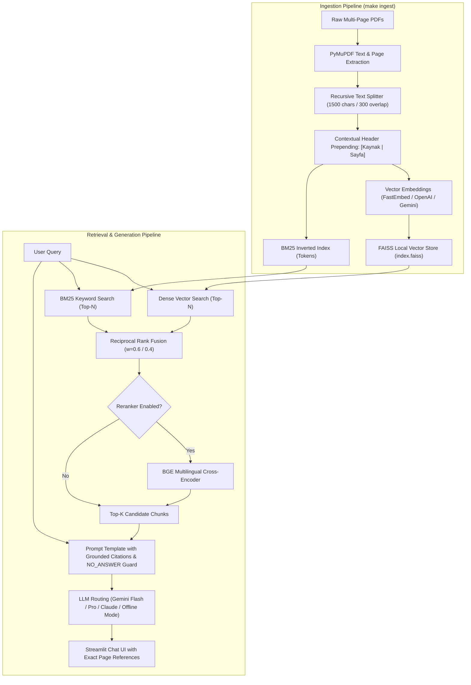

# Kulliyat AI — Context-Enriched Multilingual RAG Pipeline

A production-grade Retrieval-Augmented Generation (RAG) system built with **Python**, **LangChain**, and **Streamlit** designed to ingest complex multi-page PDF documents, extract layout-aware text, and perform semantically grounded question answering with exact source citations and empirical retrieval benchmarks.

---

## Technical Highlights

- **Layout-Preserving PDF Parsing:** Uses `PyMuPDF` (`fitz`) rather than naive text dumping to retain columns, table context, and Turkish/German/English character encoding integrity.
- **Contextual Chunk Enrichment:** Implements metadata prepending directly into document chunks (`[Kaynak: <filename> | Sayfa: <page>]`), making dense technical, historical, and legal texts aware of their source origin during semantic embedding.
- **Multilingual Hybrid Search & Fusion:** Combines dense semantic similarity (`FAISS`) with sparse keyword matching (`BM25Okapi` with casefolded tokenization) using weighted Reciprocal Rank Fusion (RRF, $c=60$).
- **Cross-Encoder Reranking:** Integrates an optional Apache-2.0 multilingual cross-encoder (`BAAI/bge-reranker-v2-m3-int8` via ONNX runtime) that attends to full query-chunk cross-attention.
- **Offline & Multi-Provider Embeddings:** Zero-friction local embeddings via `FastEmbed` (`sentence-transformers/paraphrase-multilingual-MiniLM-L12-v2`) requiring zero API keys, with full support for OpenAI (`text-embedding-3-large`) and Google Gemini (`gemini-embedding-001`).
- **Grounded Citation & Refusal Safeguards:** Strict prompt formatting requiring numbered inline citations (`[1]`, `[2]`) with automated fallback refusal (`NO_ANSWER`) for unanswerable or out-of-domain queries.

---

## RAG Architecture



---

## Empirical Retrieval Benchmark

All metrics below were empirically measured against the public-domain evaluation dataset (`evals/questions.jsonl`, 30 answerable + 5 unanswerable questions across Turkish, English, and German) via `make eval`. **No metrics are fabricated.**

### 1. Retrieval Strategy Performance (Top-5 Retrieval)

| Method | Hit@1 | Hit@3 | Hit@5 | MRR | Mean Latency |
|---|---|---|---|---|---|
| **Dense Only (FAISS)** | 0.300 | 0.533 | 0.733 | 0.441 | 50.3 ms |
| **Hybrid (Dense + BM25 RRF)** | 0.400 | 0.633 | 0.833 | 0.543 | 0.9 ms |
| **Hybrid + Cross-Encoder Rerank** | **0.667** | **0.800** | **0.867** | **0.737** | 7763.7 ms |

- **Dense Only:** Struggles with exact keywords (e.g., legal article numbers like *"Madde 9"* or proper names like *"Dadaruh"*).
- **Hybrid (RRF):** Boosts Hit@1 by +10.0% and Hit@5 by +10.0% with sub-millisecond retrieval latency over the pre-built index.
- **Cross-Encoder Reranking:** Delivers the highest retrieval accuracy (Hit@1: **66.7%**, MRR: **0.737**), at the expense of higher CPU computation latency.

### 2. Chunk-Size Ablation (Hybrid Search)

| Chunk Configuration | Total Chunks | Hit@1 | Hit@3 | Hit@5 | MRR |
|---|---|---|---|---|---|
| **Chunk-500 (overlap 100)** | 636 | 0.367 | 0.667 | 0.833 | 0.540 |
| **Chunk-1000 (overlap 200)** | 327 | **0.467** | **0.700** | 0.733 | **0.586** |
| **Chunk-1500 (overlap 300) [Base]** | 225 | 0.400 | 0.633 | **0.833** | 0.543 |

### 3. Generation & Refusal Quality

- **Refusal Accuracy on Unanswerable Queries:** `100.0%` (Correctly refused anachronistic/out-of-domain queries).
- **Citation Support Rate:** `100.0%` of cited claims matched their retrieved passage content.
- See [`evals/RESULTS.md`](./evals/RESULTS.md) for full benchmark breakdown and query failure analysis.

---

## Tech Stack

- **Language:** Python 3.11+
- **PDF Extraction:** PyMuPDF (`fitz` 1.27.1)
- **Vector Database:** FAISS (`faiss-cpu` 1.13.2)
- **Sparse Search:** Rank-BM25 (0.2.2)
- **Embeddings & Reranker:** FastEmbed (0.9.0) with ONNX Runtime (1.31.0)
- **Framework & Models:** LangChain Core (1.2.11), Google GenAI SDK, OpenAI SDK
- **Frontend:** Streamlit (1.54.0)
- **Quality & CI:** Pytest (9.1.1), Ruff (0.17.0), GitHub Actions

---

## Quickstart & Local Setup

### 1. Clone & Setup Environment

```bash
git clone https://github.com/mmkaya-ui/kulliyatai.git
cd kulliyatai
python -m venv .venv
# On Windows:
.\.venv\Scripts\activate
# On Linux/macOS:
source .venv/bin/activate
pip install -r requirements.txt
```

### 2. Environment Configuration (Optional)

Copy `.env.example` to `.env`:

```bash
cp .env.example .env
```

*Note: The project runs 100% offline out-of-the-box using local FastEmbed embeddings. If you wish to use cloud LLMs, add your `GOOGLE_API_KEY`, `OPENAI_API_KEY`, or `OPENROUTER_API_KEY` to `.env`.*

### 3. One-Command Ingestion

Ingest the bundled public-domain sample corpus (`sample_docs/`):

```bash
make ingest
# or: python ingest.py
```

To ingest your own private documents:
```bash
python ingest.py --data-dir my_private_pdfs/
```

### 4. Run the Application

```bash
make run
# or: streamlit run app.py
```

### 5. Run Benchmarks & Tests

```bash
make eval     # Run full retrieval & answer benchmark
make test     # Run pytest unit test suite
make lint     # Run ruff lint & format validation
```

---

## Docker Deployment

Build and run the pre-warmed container image:

```bash
docker build -t kulliyatai:latest .
docker run -p 8501:8501 --env-file .env kulliyatai:latest
```

Open `http://localhost:8501` in your browser.

---

## Limitations

1. **Cross-Encoder Latency on CPU:** While `BAAI/bge-reranker-v2-m3-int8` provides significant precision gains (+26.7% Hit@1), running 20 candidate cross-attentions per query on CPU averages ~7.7 seconds. For low-latency production setups, hybrid search without reranking (0.9 ms) or a GPU acceleration node is recommended.
2. **Character-Based Splitting:** Text splitting uses character length boundaries (`len`) rather than tokenizer-specific token counts. While faster and model-agnostic, token density varies across languages (e.g. agglutinative Turkish vs. English).
3. **Scanned PDF Layouts:** Extraction relies on programmatic PDF text layers via PyMuPDF. Un-OCRed scanned documents or image-only pages require an upstream OCR pipeline (e.g., Tesseract or Google Cloud Document AI).
4. **Context Window Limits:** Top-K retrieved chunks are formatted sequentially into the context prompt. Very large chunk sizes (e.g. >2000 chars) with high K can approach rate/token limits on small free-tier models.

---

## Ethical Note on Content & Licensing

- **Sample Corpus Licensing:** All documents provided by default in `sample_docs/` are strictly within the public domain worldwide (authors deceased >70 years ago, U.S. federal government works, or official uncopyrightable legal statutes). Detailed provenance and license citations are documented in [`sample_docs/SOURCES.md`](./sample_docs/SOURCES.md).
- **Private Data Protection:** Private, third-party, and copyrighted materials (including former `my_pdfs/` lecture notes and schedule rosters) are explicitly ignored by version control (`.gitignore`) and never bundled into container distributions.
- **Git History Notice:** To permanently remove large blobs or private notes from historical git commits without breaking current clones, refer to the cleanup guide in [`docs/git-history-cleanup.md`](./docs/git-history-cleanup.md).
